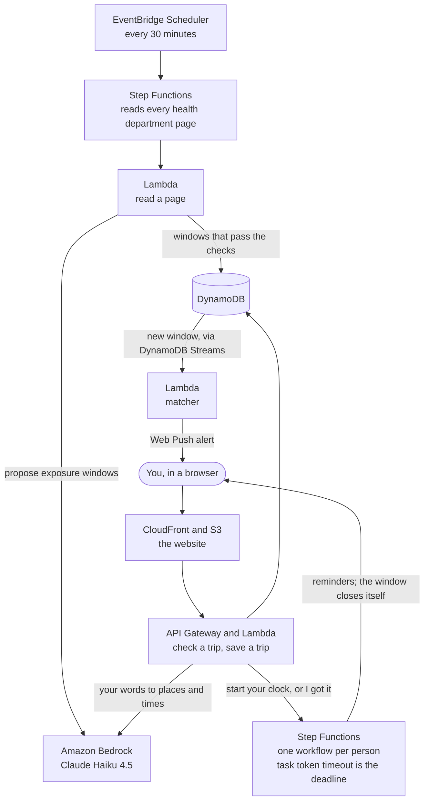

# Seventy-Two

**Were you where measles was?** After a measles exposure, a person who is not immune has 72 hours to get the MMR vaccine and 6 days to get immune globulin. The public notice usually comes too late. Seventy-Two reads US health department exposure notices every 30 minutes, tells you in seconds whether your trip matches one, alerts your phone if a new notice matches later, and runs your deadlines as your own AWS Step Functions workflow.

| | |
|---|---|
| **Demo video (2:32)** | https://youtu.be/9ZU9kDXOyHI |
| **Live site** | https://d2y9hj2jlfzcvd.cloudfront.net |
| **Live metrics and alarms** | https://d2y9hj2jlfzcvd.cloudfront.net/ops/ |
| **Write-up** | [AWS Builder Center project](https://builder.aws.com/project/3MCI9hpfcQzzb0AT956B4Y8mPhk/seventy-two-reads-us-measles-exposure-notices-matches-them-to-your-trip-and-runs-your-72-hour-clock-as-your-own-step-functions-workflow) |
| **Stack** | Serverless AWS only: no servers, no containers, no deployment pipeline. One command deploys it. |

Built for the AWS Builder Center weekend challenge "No Pipeline, No Problem" (November 13 to 16, 2026). Not medical advice.

## The problem

I measured how late measles exposure notices are. Across **70 exposures** in dated press releases from **10 US health departments**:

- the median time from exposure to public notice was **5.2 days**;
- **57 of 70** notices went up after the 72-hour vaccine window had closed;
- **30 of 70** went up after the 6-day immune globulin window had closed too.

How it was measured: the publication date of each press release minus the date of the exposure it lists, with the same exposure reported on several pages counted once. Publication dates are days, so each lag is accurate to within a day. Without the two largest county outbreaks the median is still 5.2 days. `python scripts/stats.py` recomputes the numbers from the stored notices, and the live site shows them.

The deadlines come from the CDC: the MMR vaccine within 72 hours of first exposure, immune globulin within 6 days, and symptom watch from day 5 to day 21 ([sources](#sources)).

## What it does

- **Check.** Type where you were in your own words, for example "PHL, Sunday Sept 13, Terminal B, 8 to 11:30 pm". In about a second it says whether that matches a notice, what is still open and until when, quotes the notice, and gives the health department's phone number.
- **Watch.** No match today can mean no notice yet. Save the trip and, for 21 days, every new exposure window is checked against it the moment it is stored. A match reaches your phone as a notification and your calendar as an event.
- **Clock.** Once you know you were exposed, your deadlines run as your own Step Functions workflow. It reminds you before each one, closes each window on its own at the deadline, and deletes its record when the watch ends.

## Try it in two minutes

| Step | Do this on the live site | You should see |
|---|---|---|
| 1 | Press **Try a real 2026 exposure** | The Philadelphia airport exposure of Sept 13, as it read on Sept 19: the vaccine window closed, immune globulin open, 8 hours left |
| 2 | Press **See your full result and start your clock**, keep **demo speed** on, press **Start my clock** | Your own Step Functions workflow, running one hour per second. Each row on the page is a real step |
| 3 | Do nothing for about 10 seconds | The immune globulin window closes itself at its deadline: the task token timed out |
| 4 | Start another clock and press **I got immune globulin** before the deadline | The workflow resumes from its task token instead |
| 5 | Open **Lab**, choose **Hepatitis A**, press **Use a real hepatitis A notice** | The same stack reads a real New York City hepatitis A notice with a second rule file |
| 6 | Open **Ops** | The stack's last 24 hours from CloudWatch, its eight alarms and its X-Ray service map |

## Architecture



Also in the stack: S3 keeps every notice read and a snapshot of the board, which CloudFront serves if the API fails; SQS keeps any batch the matcher could not finish; a Lambda function runs each clock step. Every function reports to **CloudWatch** (metrics from log lines, eight alarms) and **AWS X-Ray** (traces), and the API reads both back for the public Ops page.

## How it works

1. **Read.** EventBridge Scheduler starts the ingest workflow every 30 minutes. A Distributed Map runs each health department page as a short Express child, six at a time, with retries. An unchanged page stops at its hash. A changed page is archived to S3, and Claude Haiku 4.5 on Amazon Bedrock proposes exposure windows. **Code then checks every answer against the notice:** the quote must be in the notice word for word, the date must be in the quote or the nearest date heading above it, the place must be named nearby, the times must be inside the quote, and the time zone must match the state. Windows that pass are stored in DynamoDB (`src/reader.py`, `src/evidence.py`).
2. **Check.** CloudFront sends `/api/*` to API Gateway and the API Lambda. Claude only turns your words into places and times. Plain code decides overlap and computes the deadlines (`src/rules.py`, `src/trips.py`).
3. **Watch.** A saved trip files each stop under its state and day. DynamoDB Streams sends each new window to the matcher, which reads only the stops filed under that state and those days, and writes a match with optimistic locking so the same exposure never alerts twice (`src/watch.py`). Alerts are Web Push notifications (`src/push.py`, RFC 8291 and RFC 8292) and a calendar feed.
4. **Clock.** Each person's clock is one Step Functions Standard workflow: a Map over their deadlines, each a Wait state, a reminder, and a **task token whose timeout is the deadline**. "I got it" sends the token back; if nobody does, the timeout closes the window. Waiting costs nothing, and no code polls a table (`src/clock.py`, the `ClockStateMachine` in `template.yaml`).
5. **Forget.** Saved trips, clocks and Lab results carry a DynamoDB TTL. Logs are kept 14 days.

If the API fails, CloudFront serves the board from its S3 snapshot.

### AWS services

| Service | What it does here |
|---|---|
| Amazon EventBridge Scheduler | Starts the read every 30 minutes |
| AWS Step Functions | The ingest workflow (Distributed Map, Express children), and one Standard workflow per person for their clock |
| AWS Lambda | Five functions: read a page, publish the board, the API, the matcher, the clock steps (Python 3.12, arm64) |
| Amazon Bedrock | Claude Haiku 4.5 reads notices and turns trips into places and times |
| Amazon DynamoDB and Streams | Exposure windows, saved trips and clocks in one table; new windows stream to the matcher |
| Amazon S3 | The website, every notice read, the source list, the board snapshot |
| Amazon API Gateway (HTTP API) | 16 throttled routes; refuses calls that skip CloudFront |
| Amazon CloudFront | HTTPS, a one-minute cache for the board, failover to the S3 snapshot |
| Amazon SQS | Keeps any stream batch the matcher could not finish, for `scripts/replay.py` |
| Amazon CloudWatch and AWS X-Ray | Metrics, eight alarms, a dashboard, saved queries and traces, all shown on the Ops page |
| Supporting | AWS SAM and CloudFormation (one template), SNS for alarm email, IAM (one role per function), SSM Parameter Store for the push signing key and the CloudFront origin secret |

## Results

**Reading notices** (`bench/`, full tables in [bench/results.md](bench/results.md) and [bench/reuse.md](bench/reuse.md)):

| Test | Seventy-Two | Regex baseline |
|---|---|---|
| Exposure windows matched exactly (place, date, start and end time) in 11 real notices, every window labeled by hand | **34 of 34** | 0 of the 12 in four of these notices |
| Held out: 3 notices from departments it does not read, labeled first, scored once | **3 of 5**, 0 false | |
| Windows created from 13 real measles pages that are not exposure notices | **0** | 9, all false |
| "Watch until" dates that no notice printed (Claude alone made 17) | **0** | |
| Answers broken on purpose (wrong date, place or quote) that the checks reject | **114 of 114** | |
| Two real hepatitis A notices, same code with the second rule file | **2 of 2** | |

The two held-out misses read one sentence naming two days as one two-day window. The measles benchmark costs about $0.19 to rerun.

**The clock and the live stack** (logs in `docs/`):

| Test | Result |
|---|---|
| 100 clocks, each told "I acted" within a second either side of its deadline | All 100 ended exactly once (32 acted, 68 missed); every answer agreed with its workflow |
| 50 real-speed clocks, nobody pressing anything | All 50 closed on their own, none early: median 1.0 s, at most 1.5 s after the deadline |
| The alternative: 50 one-time EventBridge Scheduler schedules | All fired, none early, but a median of 24 s and up to 50 s late |
| A drill notice through the real ingest function | Claude read it in about 6 s; it reached a saved trip about 5 s later; the push service accepted the alert |
| New notice to matching saved trip, 29 drills | Median 4.4 s |
| 10,000 saved trips, an ordinary new window | 3.5 to 4.5 DynamoDB read units, against 675 reading every trip; the same matches |
| An airport window 300 of those trips passed through | 300 matches in 2.3 s of matcher time |
| 2,000 requests through CloudFront, 40 at a time | 0 errors, median 32 ms |
| Scheduled reads over 24 hours | 50 of 50 succeeded, never more than 30.0 minutes apart |
| API forced to fail | CloudFront served the S3 snapshot of the board |

**Cost:** about $3.70 to $7.60 a month at list price, from the stack's own metrics (`scripts/cost.py`). Claude costs about $0.006 per changed notice.

## Run the tests

The unit tests need no AWS account: DynamoDB is replaced by an in-memory double (`tests/fake_ddb.py`).

```
python -m venv .venv
.venv/Scripts/pip install "anthropic[bedrock]>=1.17,<2" tzdata cryptography pytest pyyaml   # macOS and Linux: .venv/bin/pip
.venv/Scripts/python -m pytest -q
```

Expected: `61 passed` in under 10 seconds. They cover the CDC rules, the evidence checks, trip matching and the stream matcher (including two departments racing on one exposure), the API's limits, Web Push against the RFC 8291 test vector, the metrics behind the Ops page, the hepatitis A domain, the Lab's refusal of private addresses, and the deadline-clock pattern's own function.

These rerun the other results. They need AWS credentials, and the ones marked "live stack" need a deployed stack:

| What | Command |
|---|---|
| Reading benchmark, held out, non-notices, broken answers | `python bench/run.py` |
| Hepatitis A with the second rule file | `python bench/reuse.py` |
| Drills on the live stack: notice to trip, failover, clock at its deadline | `python scripts/drill.py trip`, `failover`, `clock` |
| Scale tests on the live stack (deletes what it makes) | `python scripts/scale.py all` |
| The clock against EventBridge Scheduler | `python bench/clock_vs_scheduler.py` |
| 100 clocks racing "I acted" against the deadline | `python bench/clock_race.py` |
| The standalone clock, deployed and torn down | `python patterns/deadline-clock/try_it.py` |
| The lag numbers above | `python scripts/stats.py` |

## Deploy your own

```
python scripts/deploy.py --ingest
```

`deploy.py` builds the Lambda code and an arm64 dependency layer, creates the push signing key in SSM if it is missing, deploys `template.yaml` as a CloudFormation change set, uploads the source list and the website, and starts one read. It needs AWS credentials and Amazon Bedrock access to Claude Haiku 4.5 in the region. Settings come from the environment, for example `STACK=my-copy REGION=us-west-2 ALERT_EMAIL=you@example.org python scripts/deploy.py`.

## Reuse

**The clock alone, for any app with deadlines.** `patterns/deadline-clock/` is the clock without measles, Claude or a website: one DynamoDB table, one Lambda function, one Step Functions state machine and one SNS topic, about 190 lines. Deploy it with `sam deploy --guided`; there is nothing to build. Start one execution per person with their deadlines; reminders, "acted" and "missed" arrive on the SNS topic, and each reminder carries a one-click "I did it" link. Its [README](patterns/deadline-clock/README.md) has the commands. On AWS, 4 of 4 test clocks passed, each ignored deadline closing itself 0.21 to 0.59 s after it passed (`runs.json`).

**Another disease.** Everything specific to measles is in one file, `src/domains/measles.py`: what a notice is, the actions and their windows, the watch period and the words. `src/domains/hepatitis_a.py` is a second one, and it runs live in the Lab on the same stack and the same clock workflow. A full copy for hepatitis A is one command:

```
STACK=hepatitis-a DOMAIN=hepatitis_a SOURCES=sources/hepatitis_a.json python scripts/deploy.py --ingest
```

## Limits

- It reads 31 pages from 16 health departments in 13 states, plus the notices their news lists link to. A notice from elsewhere can be pasted into the Lab.
- "Still open" is an upper bound, because publication dates are days, not hours.
- Alerts need a browser with Web Push (on iPhone, add the site to the Home Screen first).
- The scale tests ran from one laptop against one stack: they show how the design behaves, not a ceiling.
- It is not medical advice and does not know anyone's vaccine record. It always gives the health department's phone number.

## Sources

- **Post-exposure deadlines.** CDC, [Measles vaccine considerations](https://www.cdc.gov/measles/hcp/vaccine-considerations/index.html) (MMR within 72 hours); CDC, [Immune globulin for post-exposure prophylaxis](https://www.cdc.gov/measles/downloads/measles-immune-globulin-post-exposure-prophylaxis.pdf) (within 6 days); CDC, [Measles exposure guide for healthcare settings](https://www.cdc.gov/infection-control/media/pdfs/Measles-Exposure-Guide-HC-Settings-508.pdf) (symptom watch, day 5 to day 21). Hepatitis A: CDC, [Clinical overview](https://www.cdc.gov/hepatitis-a/hcp/clinical-overview/index.html).
- **2026 case count.** CDC, [Measles cases and outbreaks](https://www.cdc.gov/measles/data-research/index.html): 5,412 US cases as of November 12, 2026, the most since 1991.
- **Elimination status.** CNN, [the US loses its measles elimination status](https://www.cnn.com/2026/11/13/health/us-measles-elimination-status), November 13, 2026.
- **Exposure notices.** The 31 health department pages in [`sources/sources.json`](sources/sources.json). Every notice read is archived by content hash, and each window on the site links to its notice.
- **Prior art.** The [CORI measles dashboard](https://cori.centerforhealthsecurity.org/outbreak/measles-dashboard/) kept a hand-made exposure map until September 30, 2026. Matching where people were against exposure sites goes back to check-in apps such as New Zealand's COVID Tracer. A Step Functions task token with a timeout is a documented AWS pattern, usually used for human approval.
- **Web Push.** [RFC 8291](https://www.rfc-editor.org/rfc/rfc8291) (message encryption) and [RFC 8292](https://www.rfc-editor.org/rfc/rfc8292) (VAPID).

## Repository

```
template.yaml             every AWS resource (AWS SAM)
src/                      the Lambda code: reader and evidence checks, rules, trips, matcher, clock, API, push, metrics
src/domains/              one file per disease: measles.py, hepatitis_a.py
sources/                  the health department pages it reads
web/                      the website (static HTML, CSS and small JavaScript modules)
tests/                    unit tests (no AWS account needed)
bench/                    hand-labeled real notices, the reading benchmark, the clock benchmarks
scripts/                  deploy, build, render, stats, drills, scale tests, replay, recheck, cost
docs/                     architecture diagram, screenshots, drill, scale and race logs
patterns/deadline-clock/  the clock alone, as a standalone SAM template
```

License: [Apache-2.0](LICENSE).
